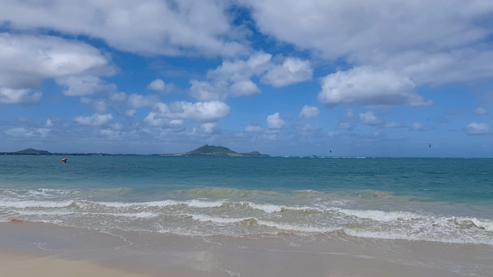
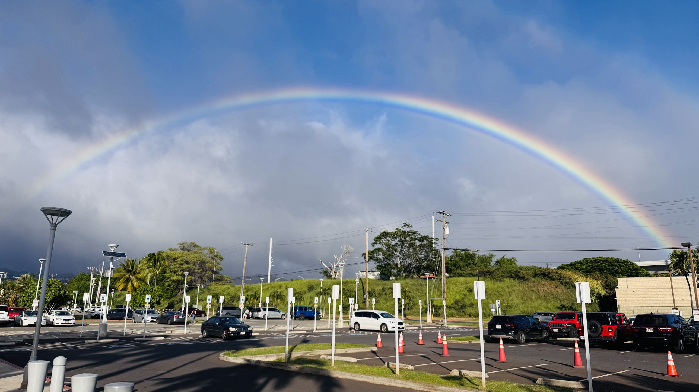
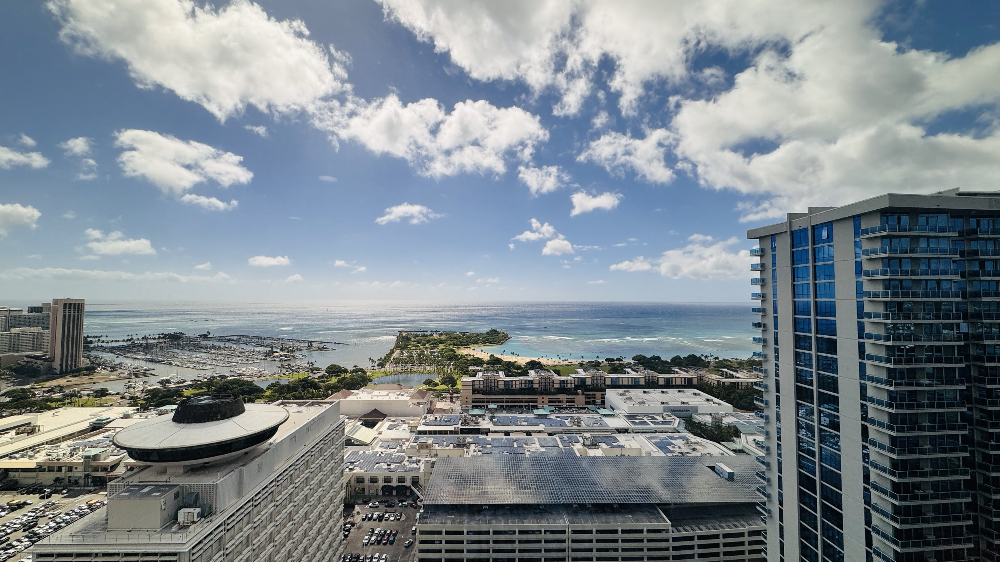
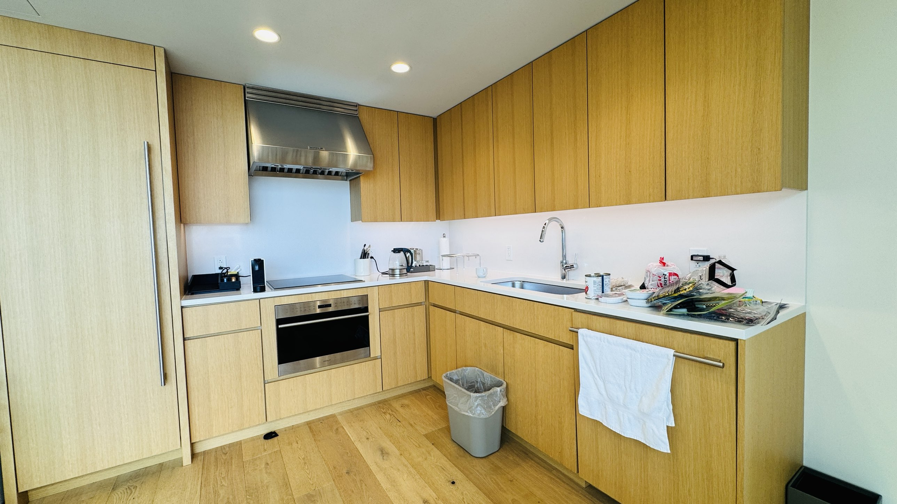
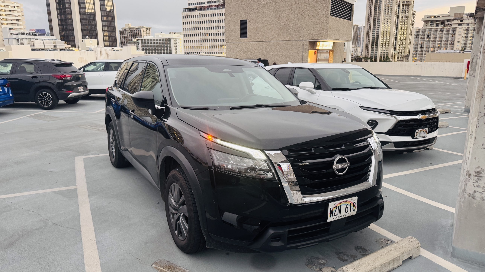
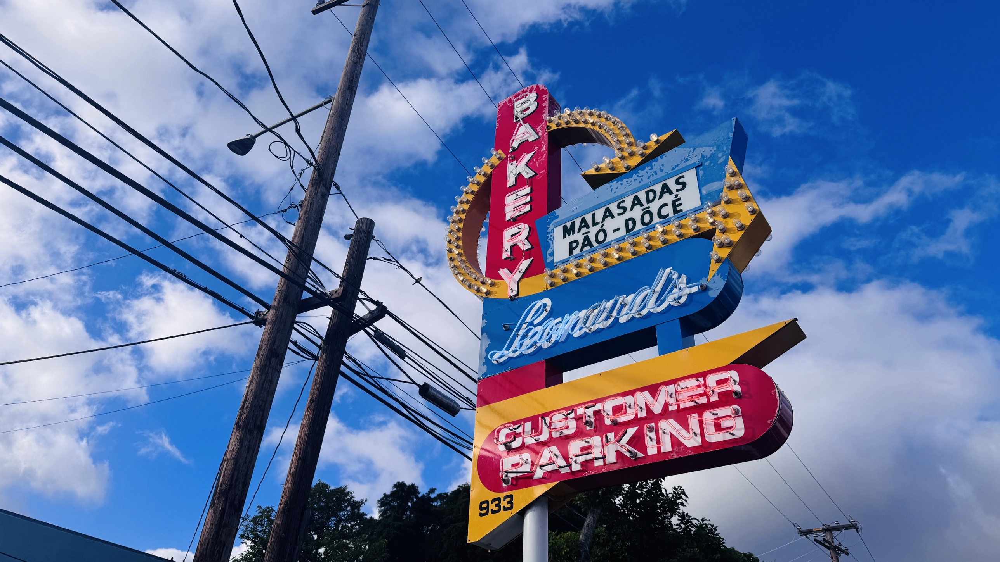
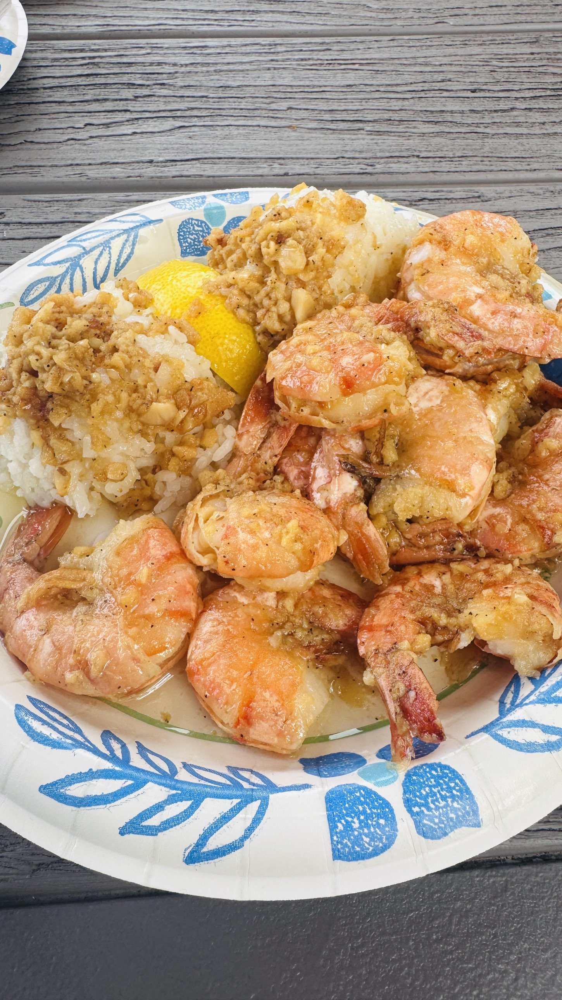
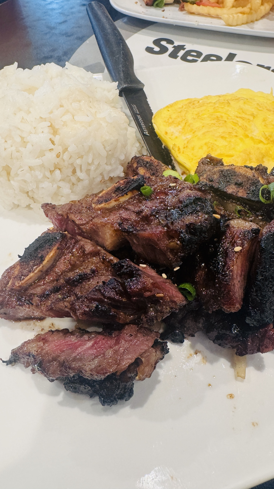

ハワイか、東南アジアか。

海外旅行の行き先に悩んだとき、この二択で迷う人は意外と多いと思う。

今回、実際にハワイ（オアフ島）へ行ってきた。東南アジアの島々はこれまで散々巡ってきたので、ちょうどいい比較ができそうだと思い、「実際に行った感覚」でハワイと東南アジアを比べてみる。

先に言っておくと、海の綺麗さだけで言えば、正直ハワイは東南アジアの猛者たちにはちょっと敵わない。でも、それでもハワイには東南アジアにはない魅力がちゃんとある。

## まず結論｜こういう人にはこっち

- **とにかく海の透明度にこだわりたい** → 東南アジア（レダン島・リペ島クラスには敵わない）
- **清潔さ・快適さ・言葉の心配をしたくない** → ハワイ
- **部屋からの眺めやバルコニーを楽しみたい** → ハワイ
- **乗り継ぎなしの直行便でシンプルに行きたい** → ハワイ
- **同じ予算でもっと長く・贅沢に過ごしたい** → 東南アジア
- **現地の料理・カオスな空気感を楽しみたい** → 東南アジア
- **「何も起きない」安心感が欲しい** → ハワイ
- **旅先での「ハプニング」そのものを楽しみたい** → 東南アジア

## ハワイの魅力｜とにかく快適、とにかく安心

### 気候と街の清潔さ

東南アジアは日差しが強くて、湿度も気温も高い。一方ハワイは、日差しは強いのに湿度が低くて、気温もそこまで高くない。カラッとしていて過ごしやすい。

雨が降っても、ハワイの雨は霧雨というかシャワーみたいな感じで、濡れてもそこまで嫌な気分にならない。雨上がりには、駐車場の向こうに大きな虹がかかっていたこともあった。

街もとにかく綺麗。ゴミが少なくて、路上飲酒もあまり見かけない。公共の場での振る舞いがちゃんとしている印象で、そのせいか海沿いの街並みがそのまま綺麗な海と隣接していて、街歩きだけでも気持ちがいい。

### 言葉の壁がほぼない

ハワイは日本語表記や日本語が通じる場面がかなり多い。英語に自信がなくても、現地の人はゆっくりはっきり話してくれるので、変に身構えなくていい。

長年英語を勉強してきたし、東南アジアの旅行では特に困ったことがなかったので、ハワイでも自信満々で過ごしていた。ところが、エレベーターで一緒になった観光客の早口の英語が全く聞き取れず、見事に撃沈した。これまで理解できていたのは、ハワイの人たちがこちらに合わせてゆっくり話してくれていたからだった。

### 部屋からの眺めとキッチン付きの客室

ホテルの部屋の広さや値段だけで言えば、むしろ東南アジアの方が安くて広い部屋に泊まれることが多い（このあたりは後述の予算比較でも数字に出ている）。ただハワイは、海やダイヤモンドヘッドが見えるバルコニー付きの客室に当たりやすい印象だった。

キッチン付きの部屋に泊まれば、現地のスーパーで食材を買って自炊もできる。今回泊まった部屋は本格的なキッチン（オーブンやネスプレッソまで）付きだったので、外食コストを下げるために自炊もした。

### レンタカーでの自走

今回はレンタカーでオアフ島を回った。自分たちのペースでビーチも街もコーヒー農園も回れるのは気楽だった（返却時のピックアップ待ちに1時間以上かかったのは誤算だったけど）。

東南アジアでも運転自体はできるが、Grabやタクシー、バイクタクシーで移動することの方が多い。どちらのスタイルで動くかは、行き先と好み次第だと思う。

## 東南アジアの魅力｜海の透明度と、カオスな楽しさ

### 海の透明度は、正直ハワイの一枚上

これまで訪れた中で、海の綺麗さだけで並べるなら、個人的には レダン島 ＞ リペ島 ＞ グアム ＞ ハワイ、という順番になる。

ハワイの海も十分綺麗だけど、[レダン島](/2026/09/30/redang-guide/)や[リペ島](/2026/09/30/koh-lipe-guide/)の透明度を知ってしまうと、「あれ、ハワイってこんなものだっけ」と思ってしまう自分がいた。これは正直な実感として書いておきたい。

### 食は東南アジアの屋台飯に軍配

ハワイの食事も美味しかった。マラサダ（ポルトガル発祥のドーナツ）やガーリックシュリンプ、マカダミアナッツパンケーキなど、ハワイらしい一皿はちゃんと楽しめる。ただ方向性としては「アメリカナイズ＋ローカルフュージョン」寄り。

韓国系とハワイが混ざったプレートランチなど独自の進化はしているけど、「現地の文化そのものを食べている」感覚は東南アジアの屋台飯の方が強い。

東南アジアは、屋台や食堂で現地の人と同じものを安く食べられる。この「生活に混ざる」感覚は、ハワイでは味わいにくい。

### ハプニングがあるから、記憶に残る

これが今回一番書きたかったことかもしれない。

ハワイは本当に快適だった。でも快適すぎて、これといった「ハプニング」が一つもなかった。毎日が淡々と過ぎていく感じ。

東南アジアだと、バスが時間通りに来ない、ホテルの部屋の様子がなんだかおかしい、店員と謎の攻防戦になる……みたいな「事件」が高確率で起きる。でも振り返ってみると、旅の記憶に残っているのはだいたいそういう予定外の出来事だったりする。

ハワイに「ハプニングがない」のは快適さの裏返しでもある。でも「東南アジア旅行の方が記憶に残る」理由の正体は、まさにこの「ハプニング濃度」の差なんじゃないかと思う。

## 予算徹底比較｜実際いくらかかった？

今回のハワイ旅行（オアフ島・7泊8日、うち機内1泊）で実際にかかった費用を、1人あたりに換算するとこうなる。

| 項目 | 1人あたり |
|---|---|
| ホテル | ¥138,693 |
| 航空券（ANA／ゆる旅クラス） | ¥117,530 |
| 食事 | ¥18,251 |
| 買い物 | ¥8,906 |
| ESTA | ¥6,647 |
| タクシー | ¥6,060 |
| レンタカー | ¥5,754 |
| 食材（自炊分） | ¥3,601 |
| バス | ¥1,975 |
| 駐車代 | ¥735 |
| **合計** | **¥308,151** |

（食材費はキッチン付きの部屋で自炊した分。外食の食事費とは別枠で計上している）

TRIP×TRIPで紹介している東南アジアの島旅は、同じくらいの日程なら「やす旅」で8万円前後、ちょっと贅沢な「らぐ旅」でも25万円前後が目安。ハワイの1人あたり¥308,151は、東南アジアの「らぐ旅」予算よりさらに上、というのが実感に近い。

一番の差はホテルと航空券。今回のホテル代は1泊あたり1人約2.3万円（6泊換算）。これは人数分でシェアした実費の平均で、2人1部屋を基準にしている東南アジアの予算プランとは前提が少し違う点は注意したいが、それでも東南アジアの同クラスのリゾートよりはっきり高い水準だった。「同じ予算でも、東南アジアの方が長く・贅沢に過ごせる」というのは、数字で見てもそのとおりだった。

## アクセス比較｜直行便か、乗継か

ハワイへは、羽田から直行便（ANA、片道7〜8時間）で行ける。今回も往路は羽田→ホノルル直行、復路はホノルル→成田直行で、どちらも乗り継ぎなし。時差はあるけど、移動そのものはシンプル。

一方でアメリカ領なのでESTA（電子渡航認証）の費用も人数分かかる（今回は1人あたり約¥6,647）。東南アジアは短期滞在ならビザ不要な国がほとんどで、この手間はない。

東南アジアは行き先によってはクアラルンプールやバンコクなどで乗り継ぎが必要になる島も多い。乗り継ぎの手間と直行便の楽さは、行き先次第で天秤にかける必要がある。

## どっちを選ぶ？

**ハワイがおすすめな人**
- 英語や文化の壁に不安がある
- 清潔で快適な環境を優先したい
- 乗り継ぎなしの直行便でシンプルに行きたい
- 「何も起きない」安心感のある旅がしたい
- 眺めの良いバルコニー付きの客室でゆっくりしたい

**東南アジアがおすすめな人**
- 海の透明度を最優先したい
- 同じ予算でもっと長く・贅沢に過ごしたい
- 現地の料理や空気感をディープに味わいたい
- 多少のハプニングも旅の醍醐味として楽しめる
- 乗り継ぎの手間より、コスパや海を優先したい

## 結論｜「何も起きない」快適さか、「ハプニングだらけ」の記憶に残る旅か

ハワイは本当に快適だった。清潔で、安心で、言葉の心配もいらない。でも、快適すぎて「事件」が一つも起きなかった。

東南アジアはその逆。何かしらハプニングが起きるし、思い通りにいかないことも多い。でも、そのハプニングこそが、後から振り返ったときに一番記憶に残る部分だったりする。

「快適に過ごしたいならハワイ」「記憶に残る旅がしたいなら東南アジア」。

今回ハワイに行って、むしろ東南アジア旅行の魅力を再確認した気がする。
